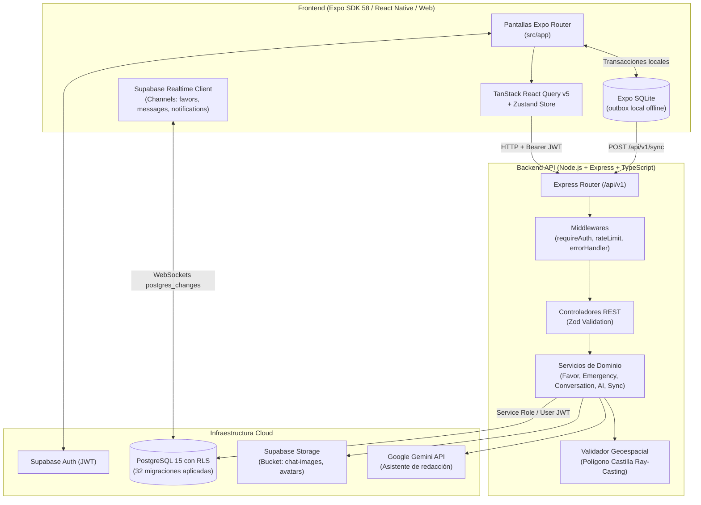

# Barrio — Plataforma Comunitaria y de Resiliencia Vecinal

**Barrio** es una plataforma móvil y web integral diseñada para reactivar el tejido vecinal y la resiliencia comunitaria. Responde al reto de conectar a los ciudadanos para acceder a productos, servicios y apoyo mutuo **a costos mínimos, con hiperproximidad (sin transporte mayor) y avalados por la confianza barrial**. 

La plataforma opera bajo un modelo de **doble estado**:
1. **Día a Día (Economía Local y Solidaria):** Directorio de oficios avalados por "Vistos Buenos Vecinales", muro colaborativo de favores sin dinero (préstamos, donaciones, ayuda temporal, intercambio de habilidades), chat privado en tiempo real con imágenes, sugerencias inteligentes asistidas por IA y mapa interactivo delimitado por zonas.
2. **Modo Emergencia (Resiliencia Comunitaria):** Evolución visual y operativa inmediata ante crisis climáticas o desastres (lluvias, desbordes, cortes de servicios): tablero de ayuda humanitaria geolocalizado con reportes de vulnerabilidad (con protección de privacidad por redondeo y opción anónima, TTL de 6h), banco solidario de recursos críticos y directorio de auxilio rápido.

Construida con arquitectura **Offline-First** (resistencia total a cortes de señal mediante SQLite y sincronización idempotente), **Tiempo Real** (Supabase Realtime) y soporte multiplataforma (**Android, iOS y Web**) sobre **Expo SDK 58 / React Native** y backend **Node.js + Express + TypeScript** bajo **Clean Architecture**.

---

## Tabla de Contenidos

1. [Alineación con el Reto de la Hackathon](#1-alineación-con-el-reto-de-la-hackathon)
2. [Arquitectura General](#2-arquitectura-general)
3. [Stack Tecnológico](#3-stack-tecnológico)
4. [Estructura del Repositorio](#4-estructura-del-repositorio)
5. [Módulos Principales del Sistema](#5-módulos-principales-del-sistema)
   - [5.1 Servicios de Proximidad (Oficios y Confianza Vecinal)](#51-servicios-de-proximidad-oficios-y-confianza-vecinal)
   - [5.2 Cadena de Favores & Red de Solidaridad (Sin Dinero)](#52-cadena-de-favores--red-de-solidaridad-sin-dinero)
   - [5.3 Modo Emergencia y Ayuda Humanitaria](#53-modo-emergencia-y-ayuda-humanitaria)
   - [5.4 Mensajería en Tiempo Real con Adjuntos](#54-mensajería-en-tiempo-real-con-adjuntos)
   - [5.5 Cartografía Vecinal y Delimitación Geoespacial](#55-cartografía-vecinal-y-delimitación-geoespacial)
   - [5.6 Asistente IA (Google Gemini)](#56-asistente-ia-google-gemini)
6. [Motor Offline-First y Resiliencia de Red](#6-motor-offline-first-y-resiliencia-de-red)
7. [Base de Datos y Migraciones (32 Versiones)](#7-base-de-datos-y-migraciones-32-versiones)
8. [Configuración e Instalación Paso a Paso](#8-configuración-e-instalación-paso-a-paso)
9. [Referencia de la API RESTful (`/api/v1`)](#9-referencia-de-la-api-restful-apiv1)
10. [Calidad de Código y Pruebas Automatizadas](#10-calidad-de-código-y-pruebas-automatizadas)

---

## 1. Alineación con el Reto de la Hackathon

| Requisito del Reto | Solución Implementada en Barrio |
| --- | --- |
| **Costo mínimo y sin transporte mayor** | Enfoque hiperlocal por sector y zona (Castilla, Piura). Filtro por cercanía métrica a pie y mapa interactivo con cálculo de distancia y tiempo de caminata. |
| **Avalados por recomendaciones vecinales** | Sistema de *"Vistos Buenos Vecinales"* (Vouches). Un profesional sólo puede ser avalado por vecinos residentes de su misma zona; al acumular 2 o más avales obtiene la insignia oficial de *Validado por vecinos*. |
| **Intercambios solidarios sin dinero** | Muro de Ayuda Comunitaria con separación clara de intenciones (**Pedir ayuda** vs **Ofrecer ayuda**) en 6 categorías: préstamo de herramientas, ayuda temporal, donación de materiales, intercambio de habilidades, movilidad solidaria y otros. |
| **Evolución en situaciones de emergencia** | Cambio dinámico de paleta y estado en toda la app. Tablero de emergencias con reportes humanitarios con TTL de 6h, banco de recursos críticos y directorio de emergencias. |
| **Privacidad en situaciones críticas** | Coordenadas de personas en riesgo redondeadas a 3 decimales (~111 m) para evitar exponer viviendas exactas. Soporte de reportes 100% anónimos. |
| **Funcionalidad Online / Offline** | Motor SQLite local (`outbox`). Permite publicar favores, reportes o recursos sin conexión. La UI responde instantáneamente y sincroniza por lotes idempotentes (`/api/v1/sync`) al recuperar red. |
| **Enfoque móvil (máximo 3 clics para publicar)** | Asistente de publicación en 3 pasos rápidos (`favores/nuevo.tsx`): 1. Tipo -> 2. Descripción/Urgencia -> 3. Confirmación en mapa. |
| **Tutorial interactivo** | Onboarding guiado en 3 láminas (`welcome.tsx`) explicando el funcionamiento del barrio, la confianza comunitaria y el modo emergencia. |

---

## 2. Arquitectura General



---

## 3. Stack Tecnológico

### Frontend
- **Framework:** [Expo](https://expo.dev/) SDK 58 (`react-native` 0.88, `react` 19.3, `react-native-web`).
- **Enrutamiento:** [Expo Router](https://docs.expo.dev/router/introduction/) v58 con navegación basada en archivos en `src/app/`.
- **Caché & Servidor:** [TanStack React Query v5](https://tanstack.com/query/v5) con invalidación selectiva y optimistic updates.
- **Estado Global:** [Zustand v5](https://github.com/pmndrs/zustand) + persistencia segura en [Expo SecureStore](https://docs.expo.dev/versions/latest/sdk/securestore/).
- **Almacenamiento Local Offline:** [Expo SQLite](https://docs.expo.dev/versions/latest/sdk/sqlite/) con tablas `outbox` y transacciones asíncronas.
- **Imágenes & Multimedia:** [Expo Image Picker](https://docs.expo.dev/versions/latest/sdk/imagepicker/) + [Expo Image Manipulator](https://docs.expo.dev/versions/latest/sdk/imagemanipulator/) para compresión y optimización previa al envío.
- **Mapas:** [Leaflet](https://leafletjs.com/) sobre `WebView` en Android/iOS e `iframe` con puente bidireccional JS en Web.
- **Geolocalización:** [Expo Location](https://docs.expo.dev/versions/latest/sdk/location/) con geocodificación inversa universal (Nominatim OpenStreetMap / APIs nativas).
- **Tipografía y Diseño:** *Outfit*, *Fraunces* e *Instrument Sans* vía `@expo-google-fonts`, íconos vectoriales `@expo/vector-icons` (Ionicons) y paleta adaptativa (`usePalette`).

### Backend
- **Entorno:** Node.js 20+ con TypeScript 5 en modo estricto.
- **Framework Web:** Express 4.x con arquitectura limpia en capas (Routes -> Middlewares -> Controllers -> Services).
- **Validación de Datos:** [Zod v4](https://zod.dev/) para contratos de entrada y sanitización tipada en todos los endpoints.
- **Seguridad:** Helmet (cabeceras HTTP seguras), CORS dinámico, rate limiting en memoria para mensajes (30/min) e IA (5/hora), y sanitización profunda contra inyección de nombres de tablas o columnas en errores de base de datos.
- **Inteligencia Artificial:** SDK oficial `@google/genai` (Google Gemini 1.5/2.0) para sugerencias de redacción clara y constructiva.
- **Pruebas:** Node.js native test runner (`tsx --test`) con 62 pruebas unitarias e integradas automatizadas.

### Base de Datos & Tiempo Real
- **Plataforma:** [Supabase](https://supabase.com/) (PostgreSQL 15 gestionado).
- **Seguridad de Datos:** Row Level Security (RLS) en todas las tablas públicas con políticas para lectura contextual, creación y roles autorizados.
- **Tiempo Real:** Canales WebSockets (`supabase_realtime`) para publicaciones de favores, mensajes de chat y avisos.

---

## 4. Estructura del Repositorio

```text
barrio-front/
├── app.json                       # Manifiesto Expo, esquema y plugins nativos
├── package.json                   # Dependencias de frontend y scripts
├── tsconfig.json                  # Configuración estricta TypeScript
├── assets/                        # Recursos de marca (logos, splash, favicon)
├── src/                           # Código fuente del Frontend
│   ├── api/
│   │   ├── client.ts              # Cliente Fetch/HTTP con inyección de Bearer JWT
│   │   └── endpoints.ts           # Funciones de consumo REST fuertemente tipadas
│   ├── app/                       # Pantallas y rutas de la aplicación (Expo Router)
│   │   ├── _layout.tsx            # Root layout: carga de fuentes, sesión, listeners de red y toast
│   │   ├── welcome.tsx            # Tutorial interactivo de bienvenida (3 pasos)
│   │   ├── register.tsx           # Login / Registro compacto adaptado a teclado móvil
│   │   ├── ubicacion.tsx          # Selector de domicilio en mapa con autocompletado
│   │   ├── emergencia.tsx         # Tablero humanitario, recursos críticos y directorio SOS
│   │   ├── reportar.tsx           # Formulario geolocalizado de vecino vulnerable (anónimo)
│   │   ├── avisos.tsx             # Bandeja de notificaciones en tiempo real
│   │   ├── chats.tsx              # Bandeja de conversaciones activas
│   │   ├── (tabs)/                # Barra de navegación principal (5 pestañas)
│   │   │   ├── _layout.tsx        # Configuración de pestañas y burbuja flotante ChatFab
│   │   │   ├── inicio.tsx         # Dashboard vecinal, alertas activas y accesos rápidos
│   │   │   ├── mapa.tsx           # Mapa interactivo general (favores, oficios y emergencias)
│   │   │   ├── oficios.tsx        # Directorio de oficios (búsqueda, filtros y distancia)
│   │   │   ├── favores.tsx        # Muro de Ayuda Comunitaria (solo favores de vecinos)
│   │   │   └── perfil.tsx         # Perfil personal, visto bueno y gestión de oficios
│   │   ├── favores/
│   │   │   ├── nuevo.tsx          # Asistente de publicación en 3 clics con soporte offline
│   │   │   ├── [id].tsx           # Detalle del favor, postulación, reporte y cierre con agradecimiento
│   │   │   └── mis-publicaciones.tsx # "Mis aportes": gestión de pedidos y ofertas propias
│   │   ├── oficio/
│   │   │   └── [id].tsx           # Ficha de oficio, avales vecinales, contacto y opciones
│   │   └── chat/
│   │       └── [id].tsx           # Chat 1 a 1 en tiempo real con adjuntos fotográficos
│   ├── components/                # Componentes reutilizables de UI
│   │   ├── AgregarOficioModal.tsx # Formulario modal para registrar oficios desde cualquier vista
│   │   ├── AppButton.tsx          # Botón accesible con variantes (accent, secondary, link, danger)
│   │   ├── AppModal.tsx           # Modal universal con animación suave y cierre por fondo
│   │   ├── BarrioMap.tsx / .web   # Visor de mapa con soporte multiplataforma
│   │   ├── ChatFab.tsx            # Botón flotante desplegable con accesos a publicar y chats
│   │   ├── FadeInView.tsx         # Animación de entrada escalonada para listas
│   │   ├── FavorCard.tsx          # Tarjeta de ayuda comunitaria con badges semánticos
│   │   ├── NotificationToast.tsx  # Alertas emergentes en tiempo real
│   │   ├── PaginationControls.tsx # Paginación universal unificada para listas
│   │   ├── ProfessionalCard.tsx   # Tarjeta de oficio con métricas de distancia y avales
│   │   └── Screen.tsx             # Wrapper de pantalla con control inteligente de safe area y teclado
│   ├── hooks/                     # Custom hooks para datos, realtime y diseño
│   ├── offline/                   # Motor SQLite y orquestador de sincronización outbox
│   ├── store/                     # Estado global en Zustand (usuario, zona, sesión)
│   ├── theme/                     # Tokens de diseño (colores, fuentes Outfit/Fraunces/Instrument Sans)
│   └── utils/                     # Algoritmos geoespaciales, formateo y loggers estructurados
├── backend/                       # API RESTful en Node.js + Express + TypeScript
│   ├── src/
│   │   ├── app.ts                 # Configuración de Express, middlewares y Swagger UI
│   │   ├── server.ts              # Servidor HTTP con apagado ordenado (graceful shutdown)
│   │   ├── controllers/           # Controladores REST con validación Zod
│   │   ├── services/              # Lógica de negocio (favores, conversaciones, emergencias, IA)
│   │   ├── middlewares/           # Autenticación JWT, verificación de ban y manejo de errores
│   │   └── utils/                 # Validadores Zod, contorno geográfico de Castilla y logger
│   └── scripts/                   # Seeds de prueba y datos de demostración
└── supabase/
    └── migrations/                # 32 migraciones SQL incrementales
```

---

## 5. Módulos Principales del Sistema

### 5.1 Servicios de Proximidad (Oficios y Confianza Vecinal)
- **Directorio Local:** Permite a cualquier vecino registrar los oficios que domina (gasfitería, electricidad, carpintería, albañilería, costura, clases, jardinería, etc.).
- **Sistema de Avales ("Visto Bueno Vecinal"):** Solo vecinos de la misma zona pueden respaldar a un profesional. Al alcanzar 2 avales, el perfil adquiere la insignia oficial de validación vecinal.
- **Cálculo de Proximidad:** Ordenamiento por cercanía geográfica en metros y minutos de caminata estimada desde la ubicación guardada del usuario.
- **Filtro del Perfil Propio:** Para evitar redundancias, el usuario no se ve a sí mismo en el directorio público de oficios.

### 5.2 Cadena de Favores & Red de Solidaridad (Sin Dinero)
- **Doble Intención:** Separación explícita entre **Pedir ayuda** (necesito una mano) y **Ofrecer ayuda** (puedo colaborar) para fomentar la reciprocidad.
- **Publicación en 3 Clics:** Formulario ultra-rápido diseñado para móviles (`favores/nuevo.tsx`), con botón de retroceso integrado y soporte offline.
- **Separación de Vistas:** El muro comunitario general muestra exclusivamente los favores y solicitudes de los demás vecinos de la zona (`mine: false`). Los aportes propios se gestionan ordenadamente en la pantalla **"Mis aportes"** (`favores/mis-publicaciones.tsx`).
- **Emparejamiento Inteligente:** Algoritmo que sugiere automáticamente vecinos y oficios cercanos compatibles cuando el usuario crea o consulta un pedido propio.
- **Cierre con Reconocimiento:** Al resolver el favor, el autor selecciona al vecino que lo apoyó, enviando un agradecimiento formal y cerrando la conversación.

### 5.3 Modo Emergencia y Ayuda Humanitaria
- **Tablero de Vulnerabilidad:** Registro geolocalizado de personas en situación crítica (ancianos solos, enfermos sin medicinas, viviendas anegadas).
- **TTL de 6 Horas:** Las alertas de emergencia expiran automáticamente a las 6 horas de su emisión (`0032_emergencias_ttl.sql`), manteniendo el tablero limpio y actualizado.
- **Privacidad por Redondeo:** Las coordenadas geográficas se redondean a 3 decimales (~111 m) para proteger la intimidad y seguridad física de las familias. Opción de reporte anónimo disponible.
- **Inventario Solidario:** Sección para ofertar o solicitar insumos de primera necesidad (agua potable, alimentos no perecibles, medicinas, linternas, refugio temporal).
- **Directorio SOS Rápido:** Marcado directo con un toque a Bomberos, Policía Nacional, SAMU y Serenazgo de Castilla.

### 5.4 Mensajería en Tiempo Real con Adjuntos
- **Chat Privado 1 a 1:** Conexión segura entre el vecino que solicita ayuda y el que se postula para brindar apoyo.
- **Imágenes Adjuntas:** Capacidad para enviar hasta 2 fotografías por mensaje (con compresión previa automática) para mostrar desperfectos, herramientas o estados de emergencia.
- **Seguridad Comunitaria:** Sistema de baneo progresivo por reportes acumulados (`0030_ban_progresivo.sql`), bloqueo mutuo entre usuarios y borrado automático de imágenes huérfanas al cerrar el favor.

### 5.5 Cartografía Vecinal y Delimitación Geoespacial
- **Polígono Oficial de Castilla:** Delimitación de perímetro distrital con algoritmo de ray-casting para verificar que los usuarios y alertas pertenezcan al ámbito vecinal de Castilla.
- **Pines Semánticos:** Diferenciación visual de favores, oficios y puntos de emergencia en el mapa con apertura de ficha resumen con un solo toque.

### 5.6 Asistente IA (Google Gemini)
- **Sugerencias Asistidas:** Integración con la API de Google Gemini en el backend para ayudar a los vecinos a redactar títulos y descripciones claras, concisas y respetuosas.
- **Límites de Uso:** Control estricto de cuota (máximo 5 sugerencias por hora por vecino) para prevenir abusos.

---

## 6. Motor Offline-First y Resiliencia de Red

En situaciones de desastre o mala conectividad móvil, Barrio continúa funcionando ininterrumpidamente:

1. **Captura Local Inmediata:** Las operaciones críticas (`create_favor`, `create_report`, `create_resource`) generan un identificador único `client_id` (UUID v4) y se almacenan en la tabla SQLite local `outbox`.
2. **Respuesta Optimista en UI:** El favor o reporte aparece al instante en la pantalla del usuario con la marca visual de sincronización pendiente, permitiendo seguir navegando sin bloqueos.
3. **Sincronización Automática en Segundo Plano:** El hook `useOfflineSync` escucha los eventos de red mediante `@react-native-community/netinfo`. Al restablecerse la conexión, invoca automáticamente `POST /api/v1/sync`.
4. **Idempotencia Garantizada:** El backend procesa el lote validando cada `client_id`. Si una operación ya fue registrada previamente, se omite de forma segura sin generar duplicados.

---

## 7. Base de Datos y Migraciones (32 Versiones)

El esquema de PostgreSQL en Supabase está versionado cronológicamente en `supabase/migrations/`:

| Versión | Archivo | Propósito Principal |
| --- | --- | --- |
| `0001` | `0001_initial_schema.sql` | Esquema base: tablas `zones`, `users`, `favors`, `oficios`, `emergency_states`, `reports`. |
| `0002` | `0002_auth_users_trigger.sql` | Trigger automático para sincronizar `auth.users` con `public.users`. |
| `0003` | `0003_seed_zones_castilla.sql` | Carga de zonas iniciales y catálogo de 12 categorías de oficios. |
| `0004` | `0004_demo_data.sql` | Carga de números de emergencia oficiales (Policía, Bomberos, SAMU). |
| `0005` | `0005_favor_type_otros.sql` | Soporte para la categoría `otros` en favores vecinales. |
| `0006` | `0006_zone_coords.sql` | Coordenadas de referencia y radios geográficos para las zonas. |
| `0007` | `0007_soft_delete_and_edit_favors.sql` | Borrado lógico (`is_deactivated`) y campos de edición en favores. |
| `0008` | `0008_favor_urgency_moderation.sql` | Niveles de urgencia (`normal`, `urgente`, `emergencia`) y moderación. |
| `0009` | `0009_grants_permissions.sql` | Políticas de privilegios para roles `anon`, `authenticated` y `service_role`. |
| `0010` | `0010_seed_users.sql` | Usuarios base para entorno de pruebas. |
| `0011` | `0011_todos_los_favores_se_moderan.sql` | Ajuste de visibilidad de favores por estado de moderación. |
| `0012` | `0012_notification_nuevo_mensaje.sql` | Tipo de notificación para mensajes entrantes en chat. |
| `0013` | `0013_chat.sql` | Tablas `conversations`, `messages` y `user_blocks` con Realtime habilitado. |
| `0014` | `0014_fn_respond_to_favor.sql` | Función transaccional RPC `respond_to_favor` para postulación e inicio de chat. |
| `0015` | `0015_seed_oficios.sql` | Catálogo completo de oficios del distrito. |
| `0016` | `0016_validacion_favores.sql` | Publicación inmediata por defecto y auto-ocultamiento a los 3 reportes. |
| `0017` | `0017_performance_indexes.sql` | Índices B-Tree optimizados para consultas por zona, estado y fechas. |
| `0018` | `0018_reparar_filas_usuarios.sql` | Integridad referencial entre perfiles y cuentas de autenticación. |
| `0019` | `0019_quitar_favor_reports_duplicado.sql` | Limpieza de restricciones duplicadas en reportes de favores. |
| `0020` | `0020_users_leer_propia.sql` | Política RLS para lectura del propio perfil de usuario. |
| `0021` | `0021_favor_intent.sql` | Soporte formal para intención de favor (`pedir` vs `ofrecer`). |
| `0022` | `0022_quitar_validacion_favor_en_bd.sql` | Desacoplamiento de validaciones de texto hacia la capa de aplicación. |
| `0023` | `0023_avatars_realtime_y_permisos_users.sql` | Permisos de Storage para avatares y eventos Realtime de usuario. |
| `0024` | `0024_unificar_zona_castilla.sql` | Unificación de zonas bajo la jurisdicción distrital de Castilla. |
| `0025` | `0025_trigger_castilla.sql` | Trigger para asignar zona de Castilla a nuevos usuarios. |
| `0026` | `0026_validar_ubicacion_castilla.sql` | Rechazo a nivel de base de datos de coordenadas fuera de Castilla. |
| `0027` | `0027_centro_cruz_de_cana_dentro.sql` | Ajuste de centroide para el sector rural de Cruz de Caña. |
| `0028` | `0028_notificar_publicaciones.sql` | Generación automática de avisos Realtime al publicar nuevos favores u oficios. |
| `0029` | `0029_datos_demo_castilla.sql` | Dataset completo de demostración para evaluación y pitch de jurados. |
| `0030` | `0030_ban_progresivo.sql` | Baneo temporal automático ante acumulación de reportes vecinales. |
| `0031` | `0031_chat_imagenes.sql` | Soporte para URLs de imágenes en `messages` y bucket `chat-images`. |
| `0032` | `0032_emergencias_ttl.sql` | Expiración automática a las 6 horas para reportes de vulnerabilidad. |

---

## 8. Configuración e Instalación Paso a Paso

### Requisitos Previos
- **Node.js** v20 o superior
- **npm** (o **bun**)
- Dispositivo móvil con **Expo Go** o emulador Android / iOS (o navegador Web moderno)
- Proyecto en **Supabase**

### 1. Clonar e Instalar Frontend
```bash
git clone https://github.com/Projects-XD/barrio-front.git
cd barrio-front
npm install
```

Configurar las variables de entorno en `.env` (en la raíz de `barrio-front/`):
```ini
EXPO_PUBLIC_SUPABASE_URL=https://<tu-proyecto>.supabase.co
EXPO_PUBLIC_SUPABASE_ANON_KEY=<tu-anon-key>
EXPO_PUBLIC_API_URL=http://localhost:3001/api/v1
```

### 2. Configurar e Iniciar Backend
```bash
cd backend
npm install
cp .env.example .env
```

Configurar `backend/.env`:
```ini
PORT=3001
NODE_ENV=development
SUPABASE_URL=https://<tu-proyecto>.supabase.co
SUPABASE_ANON_KEY=<tu-anon-key>
SUPABASE_SERVICE_ROLE_KEY=<tu-service-role-key>
GEMINI_API_KEY=<tu-api-key-de-gemini>
CORS_ORIGIN=*
```

Iniciar el servidor en modo desarrollo:
```bash
npm run dev
```
> La API estará activa en `http://localhost:3001/api/v1` y la documentación interactiva Swagger en `http://localhost:3001/api/docs`.

### 3. Cargar Datos de Demostración (Opcional para Hackathon)
Desde el directorio `backend/`:
```bash
npm run seed              # Crea usuarios vecinos de demostración
```

### 4. Iniciar la Aplicación
Desde la raíz del proyecto (`barrio-front/`):
```bash
npx expo start
```
- Presiona `w` para abrir en el navegador **Web**.
- Presiona `a` para abrir en **Android**.
- Presiona `i` para abrir en simulador **iOS**.

---

## 9. Referencia de la API RESTful (`/api/v1`)

| Módulo | Método y Ruta | Descripción | Seguridad |
| --- | --- | --- | --- |
| **Salud** | `GET /health` | Estado del servicio y conexión a Supabase | Pública |
| **Zonas** | `GET /zones` | Catálogo de sectores y límites territoriales | Pública |
| **Perfil** | `GET /profiles/me` | Obtiene el perfil completo del usuario autenticado | Bearer JWT |
| **Perfil** | `PATCH /profiles/me/location` | Actualiza la ubicación del usuario (valida perímetro de Castilla) | Bearer JWT |
| **Oficios** | `GET /profiles/oficios` | Lista de categorías de oficios disponibles | Pública |
| **Oficios** | `GET /profiles?zone_id=&category=` | Directorio de profesionales por zona y oficio | Pública |
| **Oficios** | `GET /profiles/:id` | Ficha detallada de un profesional con métricas | Pública |
| **Oficios** | `POST /profiles` | Registrar o editar un oficio personal | Bearer JWT |
| **Oficios** | `DELETE /profiles/:id` | Eliminar un oficio registrado | Bearer JWT |
| **Avales** | `POST /profiles/:id/vouch` | Otorgar visto bueno vecinal a un oficio | Bearer JWT |
| **Avales** | `DELETE /profiles/:id/vouch` | Retirar visto bueno vecinal | Bearer JWT |
| **Avales** | `GET /profiles/:id/vouch/status` | Verifica si el usuario ya avaló al profesional | Bearer JWT |
| **Favores** | `GET /favores` | Listado de favores (`zone_id`, `type`, `intent`, `mine: true/false`, paginado) | Bearer JWT |
| **Favores** | `GET /favores/:id` | Detalle completo de un favor o pedido | Bearer JWT |
| **Favores** | `POST /favores` | Publicar nuevo favor (solicitud u oferta) | Bearer JWT |
| **Favores** | `PATCH /favores/:id` | Editar título, categoría o cerrar favor | Bearer JWT |
| **Favores** | `DELETE /favores/:id` | Desactivar (soft-delete) favor propio | Bearer JWT |
| **Favores** | `POST /favores/:id/interest` | Mostrar interés e iniciar chat con el autor | Bearer JWT |
| **Favores** | `POST /favores/:id/report` | Reportar publicación inapropiada (oculta a los 3 reportes) | Bearer JWT |
| **Chat** | `GET /conversations` | Lista de chats activos del vecino | Bearer JWT |
| **Chat** | `GET /conversations/:id` | Detalle de conversación y participantes | Bearer JWT |
| **Chat** | `GET /conversations/:id/messages` | Historial cronológico de mensajes | Bearer JWT |
| **Chat** | `POST /conversations/:id/messages` | Enviar mensaje de texto y/o URLs de fotos | Bearer JWT |
| **Avisos** | `GET /notifications` | Listar notificaciones del vecino | Bearer JWT |
| **Avisos** | `PATCH /notifications/:id/read` | Marcar aviso como leído | Bearer JWT |
| **Avisos** | `DELETE /notifications/:id` | Eliminar notificación individual | Bearer JWT |
| **Avisos** | `DELETE /notifications/read` | Limpiar todas las notificaciones leídas | Bearer JWT |
| **Emergencia** | `GET /emergency/state` | Estado actual de alerta barrial | Pública |
| **Emergencia** | `GET /emergency/services` | Directorio de números de auxilio rápido | Pública |
| **Emergencia** | `GET /emergency/reports` | Listado de alertas humanitarias activas (TTL 6h) | Pública |
| **Emergencia** | `POST /emergency/reports` | Crear reporte de persona vulnerable (redondeo ~111m) | Bearer JWT |
| **Emergencia** | `PATCH /emergency/reports/:id/resolve`| Marcar reporte de vulnerabilidad como atendido | Bearer JWT |
| **Emergencia** | `GET /emergency/resources` | Banco de insumos críticos (agua, víveres, medicinas) | Pública |
| **Emergencia** | `POST /emergency/resources` | Publicar oferta o pedido de recurso crítico | Bearer JWT |
| **Asistente IA** | `POST /ai/suggest` | Sugerencias de redacción clara con Google Gemini | Bearer JWT |
| **Sync Offline**| `POST /sync` | Procesa lotes de operaciones SQLite con idempotencia | Bearer JWT |

---

## 10. Calidad de Código y Pruebas Automatizadas

El proyecto cuenta con verificación continua de tipos, linting y pruebas unitarias:

### Comandos de Calidad (Frontend)
```bash
npx tsc --noEmit        # Verificación estricta de TypeScript (0 errores)
npx eslint .            # Linter de código y React Hooks (0 advertencias)
npx expo-doctor         # Diagnóstico de dependencias del SDK de Expo
```

### Comandos de Calidad y Pruebas (Backend)
```bash
cd backend
npm run typecheck       # Verificación de tipos TypeScript en backend
npm test                # Ejecuta la suite de 62 pruebas unitarias automatizadas
npm run build           # Compilación de producción hacia dist/
```

### Cobertura de las Pruebas Unitarias (`62 passing`)
- **Servicio de Favores:** Moderación automática, cálculo de ventana de edición (24h), reporte vecinal, aislamiento de zona y paginación desglosada.
- **Servicio de Conversaciones:** Restricción de acceso a no participantes, rate-limit de mensajes, bloqueo entre vecinos, cierre ordenado y eliminación de imágenes.
- **Servicio de Asistente IA:** Comunicación segura con Gemini por cabeceras, recorte de longitud y control de límite de tasa (429).
- **Validador Geoespacial:** Verificación de coordenadas dentro del distrito de Castilla y exclusión de puntos externos (Piura ciudad, Sullana).
- **Caché y Seguridad Auth:** Validación de tokens JWT en memoria, no persistencia de tokens rechazados y manejo estricto de roles.
- **Sincronización Offline:** Idempotencia ante reintentos con el mismo `client_id` y validación de lote máximo de operaciones.
