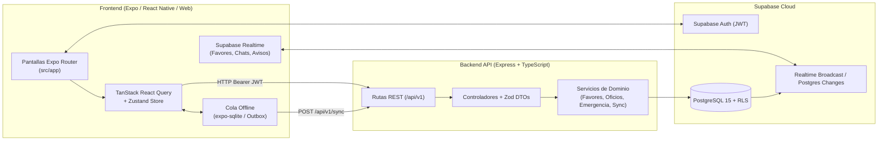

# Barrio — Plataforma Comunitaria y de Resiliencia Vecinal

**Barrio** es una plataforma móvil y web diseñada para fortalecer el tejido vecinal tanto en el **Día a Día** (directorio de oficios validados por vecinos, favores solidarios sin dinero de por medio, chat entre vecinos y mapa interactivo del barrio) como en situaciones de **Emergencia** (alertas de vulnerabilidad geolocalizadas con privacidad por redondeo, inventario solidario de recursos críticos y directorio de auxilio inmediato).

Construida con arquitectura **Offline-First**, **Tiempo Real** (Supabase Realtime) y soporte multiplataforma (**Android, iOS y Web**) sobre **Expo SDK 58 / React Native** y un backend **Node.js + Express + TypeScript** bajo **Clean Architecture**.

---

## Tabla de Contenidos

1. [Arquitectura General](#1-arquitectura-general)
2. [Stack Tecnológico](#2-stack-tecnológico)
3. [Estructura del Repositorio](#3-estructura-del-repositorio)
4. [Módulos y Funcionalidades Principales](#4-módulos-y-funcionalidades-principales)
5. [Frontend (`src/`)](#5-frontend-src)
6. [Backend (`backend/`)](#6-backend-backend)
7. [Base de Datos y Migraciones (`supabase/migrations/`)](#7-base-de-datos-y-migraciones-supabasemigrations)
8. [Motor Offline-First y Sincronización](#8-motor-offline-first-y-sincronización)
9. [Configuración e Instalación Paso a Paso](#9-configuración-e-instalación-paso-a-paso)
10. [Referencia Rápida de Endpoints REST (`/api/v1`)](#10-referencia-rápida-de-endpoints-rest-apiv1)
11. [Comandos de Desarrollo, Calidad y Pruebas](#11-comandos-de-desarrollo-calidad-y-pruebas)

---

## 1. Arquitectura General



---

## 2. Stack Tecnológico

### Frontend (Móvil & Web)
| Componente | Tecnología |
| --- | --- |
| Framework | **Expo SDK 58** (`react-native` 0.88, `react` 19.3, `react-native-web`) |
| Enrutamiento | **Expo Router** (basado en archivos en `src/app/`) |
| Estado de Servidor y Caché | **TanStack React Query v5** |
| Estado Global y Sesión | **Zustand v5** + **Expo Secure Store** |
| Almacenamiento Offline | **Expo SQLite** (`outbox` persistente en móvil y memoria en web) |
| Mapas Interactivos | **Leaflet** sobre `WebView` (móvil) e `iframe` con puente JS directo (web) |
| Geolocalización | **Expo Location** + Geocodificación inversa universal (Nominatim OSM / Nativo) |
| Tipografía e Iconografía | **Instrument Sans** (`@expo-google-fonts/instrument-sans`) + **Ionicons** |

### Backend & Base de Datos
| Componente | Tecnología |
| --- | --- |
| Runtime y Framework | **Node.js 20+** + **Express 4.x** |
| Lenguaje y Validación | **TypeScript 5.x** (modo estricto) + **Zod v4** |
| Base de Datos y Auth | **Supabase** (PostgreSQL 15, Row Level Security, Triggers y RPCs) |
| Documentación API | **Swagger / OpenAPI 3.0** (`/api/docs`) |
| Seguridad y Logging | **Helmet**, **CORS**, **Morgan**, **Winston** |
| Testing | **Node Test Runner** (`tsx --test`) |

---

## 3. Estructura del Repositorio

```text
barrio-front/
├── app.json                       # Configuración de Expo y plugins nativos
├── package.json                   # Dependencias y scripts del frontend
├── tsconfig.json                  # Configuración TypeScript del frontend
├── assets/                        # Íconos, logotipos y recursos gráficos de marca
├── src/                           # Código fuente del Frontend (Expo / React Native)
│   ├── api/
│   │   ├── client.ts              # Cliente HTTP con inyección automática de JWT y timeout
│   │   └── endpoints.ts           # Funciones tipadas de consumo REST y adaptadores snake_case -> camelCase
│   ├── app/                       # Rutas y pantallas (Expo Router)
│   │   ├── _layout.tsx            # Layout raíz (hidratación de sesión, fuentes, listener de red y realtime)
│   │   ├── index.tsx              # Redirección inicial según estado de bienvenida y sesión
│   │   ├── welcome.tsx            # Guía interactiva de onboarding (3 pasos)
│   │   ├── register.tsx           # Inicio de sesión y registro con detección GPS de zona
│   │   ├── ubicacion.tsx          # Selector de ubicación en mapa con autocompletado de dirección
│   │   ├── emergencia.tsx         # Panel de modo emergencia (servicios, alertas y recursos)
│   │   ├── reportar.tsx           # Formulario de reporte de vecino vulnerable (con opción anónima)
│   │   ├── avisos.tsx             # Bandeja de notificaciones en tiempo real
│   │   ├── chats.tsx              # Bandeja de conversaciones vecinales activas
│   │   ├── (tabs)/                # Navegador principal de pestañas
│   │   │   ├── _layout.tsx        # Configuración de las 5 pestañas inferiores + FAB de chats
│   │   │   ├── inicio.tsx         # Dashboard vecinal, accesos rápidos y favores recientes
│   │   │   ├── mapa.tsx           # Mapa interactivo del barrio (favores, pedidos, oficios y alertas)
│   │   │   ├── oficios.tsx        # Directorio de oficios con búsqueda, filtros, paginación y skeleton
│   │   │   ├── favores.tsx        # Listado paginado de favores por categoría con skeleton loader
│   │   │   └── perfil.tsx         # Perfil minimalista, gestión de ubicación y CRUD de oficios
│   │   ├── favores/
│   │   │   ├── nuevo.tsx          # Publicación de favor (solicitud u oferta) con soporte offline
│   │   │   └── [id].tsx           # Detalle de favor, postulación a chat, edición, baja y reporte
│   │   ├── oficio/
│   │   │   └── [id].tsx           # Ficha pública de oficio, vistos buenos (vouches), llamada/WhatsApp y edición
│   │   └── chat/
│   │       └── [id].tsx           # Sala de chat en tiempo real entre autor del favor y vecino interesado
│   ├── components/                # Componentes UI reutilizables
│   │   ├── AppButton.tsx          # Botón accesible multi-variante (primary, accent, secondary, danger, link)
│   │   ├── BarrioMap.tsx / .web   # Visor de mapa vecinal con clusters y selección instantánea de pines
│   │   ├── MapPicker.tsx / .web   # Selector interactivo de coordenadas con pin arrastrable
│   │   ├── mapHtml.ts             # Motor HTML/JS de Leaflet compartido entre Web y Móvil
│   │   ├── FavorCard.tsx          # Tarjeta de favor con estado de sincronización y urgencia
│   │   ├── ProfessionalCard.tsx   # Tarjeta de oficio con contador de vistos buenos
│   │   ├── SkeletonFavores.tsx    # Esqueletos animados para lista y detalle de favores
│   │   ├── SkeletonOficios.tsx    # Esqueleto animado para el directorio de oficios
│   │   └── ...                    # Card, Chip, EmptyState, Screen, StatusBanner, UrgencyBadge, etc.
│   ├── hooks/
│   │   ├── useData.ts             # Hooks de React Query (queries, mutaciones e invalidaciones)
│   │   ├── useFavorRealtime.ts    # Suscripción a cambios en vivo de `public.favors` por zona
│   │   └── usePalette.ts          # Paleta dinámica (cambia de azul a rojo en modo emergencia)
│   ├── offline/
│   │   ├── db.ts                  # Inicialización de tablas SQLite (`outbox` y `cache`)
│   │   ├── outbox.ts              # Cola local de operaciones pendientes (`create_favor`, `create_report`, etc.)
│   │   └── sync.ts                # Sincronización en lote contra `/api/v1/sync` al recuperar red
│   ├── store/
│   │   └── app-store.ts           # Estado global Zustand (usuario, zona, modo emergencia, conectividad)
│   ├── theme/                     # Sistema de diseño (colores, tipografía Instrument Sans, radios y sombras)
│   ├── types/                     # Modelos de dominio y enumeraciones TypeScript
│   └── utils/                     # Geolocalización, geocodificación inversa, formato de fechas y UUIDv4
├── backend/                       # API RESTful en Node.js + Express + TypeScript
│   ├── package.json
│   ├── API_ENDPOINTS.md           # Documentación detallada de contratos HTTP
│   ├── scripts/
│   │   ├── seed-auth.ts           # Seed de cuentas de demostración (vecinos y admin)
│   │   └── seed-20-oficios.ts     # Seed de 20 perfiles de oficios distribuidos en Piura / Castilla
│   └── src/
│       ├── app.ts                 # Configuración de Express, CORS, Helmet y Swagger
│       ├── server.ts              # Punto de entrada HTTP con cierre controlado (Graceful Shutdown)
│       ├── config/                # Variables de entorno (`env.ts`), clientes Supabase y OpenAPI
│       ├── controllers/           # Controladores HTTP por dominio
│       ├── middlewares/           # `requireAuth` (JWT), `requireAdmin` y `errorHandler`
│       ├── routes/                # Definición de rutas bajo `/api/v1`
│       ├── services/              # Lógica de negocio y pruebas unitarias (`*.service.test.ts`)
│       ├── types/                 # Definiciones de tablas PostgreSQL y extensiones de Express
│       └── utils/                 # Esquemas de validación Zod (`validators.ts`) y logger
└── supabase/
    └── migrations/                # 16 migraciones SQL incrementales (esquema, RLS, triggers, chat y validaciones)
```

---

## 4. Módulos y Funcionalidades Principales

### Día a Día
1. **Directorio de Oficios con Validación Vecinal (`/oficios`, `/oficio/[id]`):**
   - Búsqueda por texto y filtrado por 12 categorías (`gasfiteria`, `electricidad`, `carpinteria`, `albanileria`, `pintura`, `costura`, `cocina`, `jardineria`, `mecanica`, `cuidados`, `clases`, `otros`).
   - Sistema de **Vistos Buenos (Vouches)**: los vecinos de la misma zona pueden respaldar el trabajo de un profesional. Al alcanzar 3 o más vistos buenos, el oficio obtiene la insignia de **Validado por vecinos**.
   - Contacto directo mediante llamada telefónica o WhatsApp con mensaje predeterminado.
   - Gestión completa desde el perfil (crear, editar experiencia/teléfono/descripción y eliminar oficio mediante menús contextuales minimalistas).

2. **Favores Vecinales Solidarios (`/favores`, `/favores/nuevo`, `/favores/[id]`):**
   - Publicación inmediata sin fricción (`moderation_status: 'aprobado'`) tanto para **pedir un favor** como para **ofrecer ayuda**.
   - Validación automática contra contenido vacío o repetitivo y límite antispam de **5 favores diarios por vecino** (hasta **15 diarios** para vecinos confiables con `vouches_count >= 3`).
   - Moderación comunitaria colaborativa: cualquier vecino puede reportar un favor inapropiado (`Broma o spam`, `No es una ayuda real`, `Contenido ofensivo`). Al acumular **3 reportes**, el favor se desactiva automáticamente.
   - Actualización en vivo mediante **Supabase Realtime** cuando otro vecino publica, edita o elimina un favor en la zona.

3. **Chat Vecinal en Tiempo Real (`/chats`, `/chat/[id]`):**
   - Al pulsar *"Me interesa, puedo ayudar"* en un favor, se abre o recupera una conversación privada entre el autor y el vecino interesado mediante la función RPC `respond_to_favor`.
   - Mensajería instantánea suscrita por `postgres_changes` a la tabla `public.messages` y notificaciones automáticas al destinatario.

4. **Mapa Interactivo del Barrio (`/mapa`, `/ubicacion`):**
   - Visualización unificada de **Pedidos de ayuda**, **Ofertas de ayuda**, **Oficios registrados** y **Alertas de emergencia** sobre cartografía OpenStreetMap / CartoDB Voyager.
   - Comunicación directa entre el visor Leaflet y React (tanto en Web como en Móvil) para abrir al instante la tarjeta inferior de detalle al tocar cualquier marcador.
   - Selector de ubicación en el perfil con **autocompletado automático de calle/sector** (geocodificación inversa) y persistencia en base de datos (`auth.users` metadata + coordenadas de `professional_profiles`).

### Modo Emergencia
5. **Activación de Alerta Barrial y Recursos Críticos (`/emergencia`, `/reportar`):**
   - Cuando la zona entra en estado de emergencia (`emergency_states.status = 'activa'`), toda la interfaz adapta su paleta visual a tono de alerta para priorizar la respuesta rápida.
   - **Privacidad por diseño en reportes de vulnerabilidad:** las coordenadas (`lat`, `lng`) de personas vulnerables se redondean matemáticamente a 3 decimales (~111 m) antes de guardarse, evitando exponer el domicilio exacto, y se soporta el envío 100 % anónimo.
   - Inventario comunitario dividido en **Pedidos de insumos** y **Ofertas de recursos** (agua, alimentos, medicinas, refugio, transporte).

---

## 5. Frontend (`src/`)

- **Hidratación y Navegación (`src/app/_layout.tsx`):**
  Al iniciar la aplicación se hidrata el estado desde `expo-secure-store`, se inicializa la base de datos SQLite local (`initDb`), se escucha el estado de red con `@react-native-community/netinfo` para disparar `flushOutbox()` automáticamente al reconectar y se activa el canal de Realtime de la zona actual.
- **Cliente API (`src/api/client.ts`):**
  Resuelve automáticamente la URL del backend según `EXPO_PUBLIC_API_URL` o el host de desarrollo de Expo (`localhost:3001` en Web, IP LAN en dispositivo físico o `10.0.2.2:3001` en emulador Android).
- **Estados de Carga con Esqueletos (`SkeletonFavores`, `SkeletonOficios`):**
  Las listas principales y el detalle de favores utilizan componentes de esqueleto con animación de pulso nativa (`useNativeDriver: true`) en lugar de spinners genéricos, reduciendo el salto visual (CLS) y mejorando la percepción de velocidad.

---

## 6. Backend (`backend/`)

El servidor Express sigue los principios de **Clean Architecture** separando responsabilidades en capas:

1. **Routes (`backend/src/routes/`):** Define los prefijos bajo `/api/v1` y aplica los middlewares `requireAuth` y `requireAdmin`.
2. **Controllers (`backend/src/controllers/`):** Valida los parámetros de entrada (`req.body`, `req.query`, `req.params`) utilizando esquemas **Zod** (`backend/src/utils/validators.ts`) y devuelve respuestas JSON estandarizadas (`{ success, data, message, code }`).
3. **Services (`backend/src/services/`):** Contiene toda la lógica de negocio (límites diarios de favores, cálculo de vistos buenos, redondeo de privacidad en reportes de vulnerabilidad, idempotencia de sincronización offline y control de acceso por zona vecinal `zoneAccess.ts`).
4. **Clientes Supabase (`backend/src/config/supabase.ts`):**
   - `createSupabaseClient(jwt)`: ejecuta consultas respetando las políticas **Row Level Security (RLS)** del usuario autenticado.
   - `supabaseAdmin`: cliente con `SUPABASE_SERVICE_ROLE_KEY` reservado para operaciones administrativas controladas (sincronización de perfil en `public.users`, moderación comunitaria y seeds).

---

## 7. Base de Datos y Migraciones (`supabase/migrations/`)

El esquema PostgreSQL se gestiona mediante 16 migraciones versionadas en `supabase/migrations/`:

| Migración | Descripción |
| --- | --- |
| `0001_initial_schema.sql` | Crea las tablas base (`zones`, `users`, `oficios`, `professional_profiles`, `profile_vouches`, `favors`, `favor_interests`, `emergency_states`, `emergency_services`, `vulnerability_reports`, `critical_resources`, `notifications`), enums y políticas RLS. |
| `0002_auth_users_trigger.sql` | Trigger `on_auth_user_created` para sincronizar nuevos registros de `auth.users` hacia `public.users`. |
| `0003_seed_zones_castilla.sql` | Inserta las zonas vecinales iniciales de Piura / Castilla y el catálogo base de oficios. |
| `0004_demo_data.sql` | Datos iniciales de servicios de emergencia (Policía, Bomberos, SAMU, Centros de Salud). |
| `0005_favor_type_otros.sql` | Añade la categoría `otros` al enum `favor_type`. |
| `0006_zone_coords.sql` | Agrega coordenadas de referencia (`center_lat`, `center_lng`, `radius_km`) a las zonas vecinales para detección automática por GPS. |
| `0007_soft_delete_and_edit_favors.sql` | Soporte de borrado lógico (`is_deactivated`, `deactivated_by`) y edición de favores. |
| `0008_favor_urgency_moderation.sql` | Añade niveles de urgencia (`normal`, `urgente`, `emergencia`) y campos de moderación a `favors`. |
| `0009_grants_permissions.sql` | Permisos de acceso para los roles `anon`, `authenticated` y `service_role`. |
| `0010_seed_users.sql` | Preparación de perfiles base para entorno de demostración. |
| `0011_todos_los_favores_se_moderan.sql` | Ajustes de políticas de visibilidad de favores por estado de moderación. |
| `0012_notification_nuevo_mensaje.sql` | Tipo de notificación `nuevo_mensaje` para alertas de chat. |
| `0013_chat.sql` | Tablas `conversations` y `messages` con RLS y publicación en `supabase_realtime`. |
| `0014_fn_respond_to_favor.sql` | Función transaccional RPC `respond_to_favor` que registra interés y abre conversación en un solo paso. |
| `0015_seed_oficios.sql` | Asegura la presencia de las 12 categorías del catálogo de oficios. |
| `0016_validacion_favores.sql` | Publicación inmediata de favores (`DEFAULT 'aprobado'`) y tabla `favor_reports` para auto-moderación vecinal (3 reportes ocultan el favor). |

---

## 8. Motor Offline-First y Sincronización

Cuando el vecino pierde conexión a internet (`isOnline === false` o fallo de red en la petición):
1. Las acciones críticas (`create_favor`, `create_report`, `create_resource`) generan un `client_id` (UUID v4) en el dispositivo y se guardan en la tabla local `outbox` de SQLite (`src/offline/outbox.ts`).
2. La interfaz muestra inmediatamente el elemento con la etiqueta **"Sin enviar — se publicará al recuperar señal"**, permitiendo que el usuario siga utilizando la app sin bloqueos.
3. Al recuperar conectividad, `flushOutbox()` (`src/offline/sync.ts`) envía el lote completo a `POST /api/v1/sync`.
4. El backend verifica cada `client_id` para garantizar **idempotencia** (nunca se duplica un favor o reporte aunque la red falle a mitad del envío) e invalida las cachés de React Query.

---

## 9. Configuración e Instalación Paso a Paso

### Requisitos Previos
- **Node.js** v20 o superior
- **npm** (o **bun**)
- Proyecto activo en **Supabase** (con las migraciones de `supabase/migrations/` aplicadas)

### Paso 1: Clonar e instalar dependencias del Frontend
```bash
git clone https://github.com/Projects-XD/barrio-front.git
cd barrio-front
npm install
```

Crea o verifica el archivo `.env` en la raíz del proyecto:
```ini
EXPO_PUBLIC_SUPABASE_URL=https://<tu-proyecto>.supabase.co
EXPO_PUBLIC_SUPABASE_ANON_KEY=<tu-anon-key>
EXPO_PUBLIC_API_URL=http://localhost:3001/api/v1
```

### Paso 2: Configurar e iniciar el Backend
```bash
cd backend
npm install
cp .env.example .env
```

Configura las variables en `backend/.env`:
```ini
PORT=3001
NODE_ENV=development
SUPABASE_URL=https://<tu-proyecto>.supabase.co
SUPABASE_ANON_KEY=<tu-anon-key>
SUPABASE_SERVICE_ROLE_KEY=<tu-service-role-key>
CORS_ORIGIN=*
```

Inicia el servidor backend en modo desarrollo:
```bash
npm run dev
```
> El backend quedará disponible en `http://localhost:3001/api/v1` y la documentación interactiva Swagger en `http://localhost:3001/api/docs`.

### Paso 3: Poblar datos de prueba (Opcional)
Desde la carpeta `backend/`:
```bash
# Crear cuentas de demostración
npm run seed

# Poblar 20 perfiles de oficios geolocalizados en Piura / Castilla
npx tsx scripts/seed-20-oficios.ts
```

### Paso 4: Iniciar la Aplicación (Móvil / Web)
Desde la raíz del repositorio (`barrio-front/`):
```bash
npx expo start
```
- Presiona `w` para abrir en el navegador **Web**.
- Presiona `a` para abrir en **Android** (Expo Go o emulador).
- Presiona `i` para abrir en **iOS** (simulador).

---

## 10. Referencia Rápida de Endpoints REST (`/api/v1`)

| Dominio | Método y Ruta | Descripción | Auth |
| --- | --- | --- | --- |
| **Salud** | `GET /health` | Estado del servidor y latencia con Supabase | Pública |
| **Zonas** | `GET /zones` | Lista de zonas vecinales con coordenadas centrales | Pública |
| **Oficios** | `GET /profiles/oficios` | Catálogo de categorías de oficios | Pública |
| **Oficios** | `GET /profiles?zone_id=<uuid>&category=<cat>` | Listar perfiles profesionales de una zona | Pública |
| **Oficios** | `GET /profiles/:id` | Detalle de un perfil profesional | Pública |
| **Oficios** | `POST /profiles` | Crear o actualizar un oficio del usuario | Bearer JWT |
| **Oficios** | `PATCH /profiles/:id` | Editar descripción, teléfono o experiencia | Bearer JWT |
| **Oficios** | `DELETE /profiles/:id` | Eliminar un oficio propio | Bearer JWT |
| **Vouches** | `POST /profiles/:id/vouch` | Dar visto bueno vecinal a un oficio | Bearer JWT |
| **Vouches** | `DELETE /profiles/:id/vouch` | Retirar visto bueno vecinal | Bearer JWT |
| **Vouches** | `GET /profiles/:id/vouch/status` | Consultar si el usuario ya dio visto bueno | Bearer JWT |
| **Favores** | `GET /favors?zone_id=<uuid>&type=<tipo>` | Listar favores activos de la zona (paginado o completo) | Bearer / Pública |
| **Favores** | `GET /favors/:id` | Detalle completo de un favor | Bearer / Pública |
| **Favores** | `POST /favors` | Publicar un favor (límite 5/día, 15/día validados) | Bearer JWT |
| **Favores** | `PATCH /favors/:id` | Editar título/descripción/tipo o estado del favor | Bearer JWT |
| **Favores** | `DELETE /favors/:id` | Desactivar (soft-delete) un favor propio | Bearer JWT |
| **Favores** | `POST /favors/:id/interest` | Mostrar interés y abrir conversación de chat | Bearer JWT |
| **Favores** | `POST /favors/:id/report` | Reportar favor inapropiado (auto-oculta a los 3 reportes) | Bearer JWT |
| **Chat** | `GET /conversations?favor_id=<uuid>` | Listar conversaciones del usuario | Bearer JWT |
| **Chat** | `GET /conversations/:id` | Detalle de conversación | Bearer JWT |
| **Chat** | `GET /conversations/:id/messages` | Historial de mensajes de una conversación | Bearer JWT |
| **Chat** | `POST /conversations/:id/messages` | Enviar mensaje en una conversación | Bearer JWT |
| **Avisos** | `GET /notifications` | Listar avisos del usuario autenticado | Bearer JWT |
| **Avisos** | `GET /notifications/unread-count` | Contador de avisos sin leer | Bearer JWT |
| **Avisos** | `PATCH /notifications/:id/read` | Marcar aviso individual como leído | Bearer JWT |
| **Avisos** | `PATCH /notifications/read-all` | Marcar todos los avisos como leídos | Bearer JWT |
| **Emergencia** | `GET /emergency?zone_id=<uuid>` | Consultar estado de emergencia de la zona | Pública |
| **Emergencia** | `GET /emergency/services?zone_id=<uuid>` | Directorio de servicios de auxilio | Pública |
| **Emergencia** | `POST /emergency/activate` | Declarar estado de emergencia (`emergency_role`) | Bearer JWT |
| **Emergencia** | `POST /emergency/deactivate` | Levantar estado de emergencia (`emergency_role`) | Bearer JWT |
| **Reportes** | `GET /reports?zone_id=<uuid>` | Listar alertas de vulnerabilidad en la zona | Pública |
| **Reportes** | `POST /reports` | Crear reporte de vulnerabilidad (redondeo de privacidad) | Bearer JWT |
| **Recursos** | `GET /resources?zone_id=<uuid>&kind=<tipo>` | Listar pedidos u ofertas de insumos críticos | Pública |
| **Recursos** | `POST /resources` | Publicar pedido u oferta de recurso en emergencia | Bearer JWT |
| **Offline Sync** | `POST /sync` | Procesar lote de operaciones offline con idempotencia | Bearer JWT |

---

## 11. Comandos de Desarrollo, Calidad y Pruebas

### Frontend (raíz del repositorio)
```bash
npx expo start          # Inicia el servidor de desarrollo de Expo
npx tsc --noEmit        # Verificación estricta de tipos TypeScript
npx expo lint           # Linter con reglas de Expo / React Hooks
npx expo-doctor         # Diagnóstico de salud de dependencias de Expo SDK
```

### Backend (`cd backend`)
```bash
npm run dev             # Servidor en vivo con recarga (tsx watch)
npm run typecheck       # Verificación de tipos TypeScript sin emitir archivos
npm test                # Ejecuta la suite de pruebas unitarias de servicios
npm run build           # Compila TypeScript a JavaScript en dist/
npm start               # Ejecuta la versión compilada de producción
```

